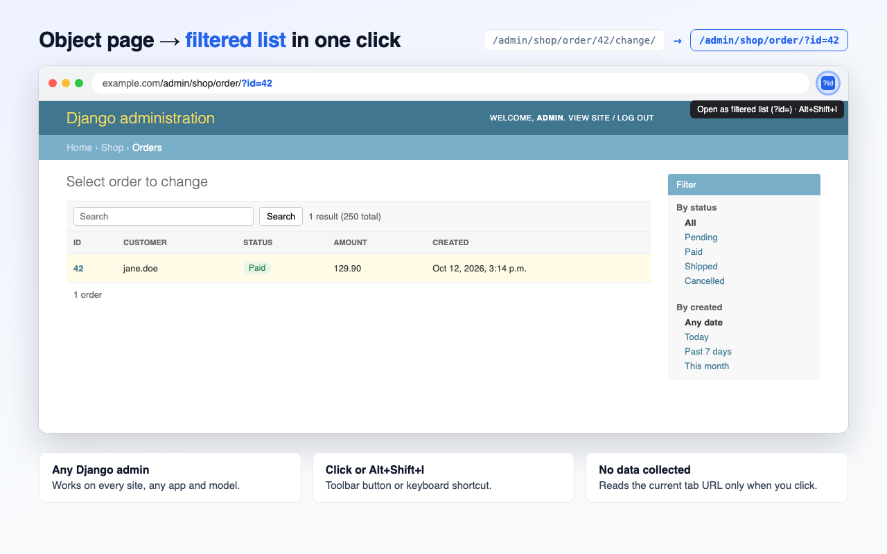

# ID Filter for Django Admin

A small Chrome extension that takes you from a Django admin **object page** to the **changelist filtered by that object's id**, in one click.

```
https://example.com/admin/shop/order/42/change/?_changelist_filters=status%3Dpaid
                                   ↓
https://example.com/admin/shop/order/?id=42
```

This is handy when you want to see an object as a row in its list, for example to compare its columns with other rows, use list actions on it, or share a link to the filtered list.



## Features

- Works on any Django admin site, on any domain, for any app and model.
- Recognises `/<id>/change/`, `/<id>/history/` and `/<id>/delete/` pages.
- Works when the admin is mounted under a prefix (`/backoffice/admin/...`).
- Drops the old query string (such as `_changelist_filters`) and sets only `?id=<id>`.
- Toolbar button and keyboard shortcut **Alt+Shift+I**.
- On a page that isn't an admin object page, the button shows a red **✗** for a moment and does nothing.

## Install

The extension isn't on the Chrome Web Store yet. You install it straight from this GitHub repository. It works in Chrome and in other Chromium browsers (Edge, Brave, Arc, Opera).

### 1. Get the code

**With git:**

```bash
git clone https://github.com/mohsen158/ID-Filter-for-Django-Admin.git
```

**Without git:** on this page, click **Code → Download ZIP**, then unzip it.

### 2. Load it in Chrome

1. Open `chrome://extensions`. In Edge, open `edge://extensions`.
2. Turn on **Developer mode** (top right).
3. Click **Load unpacked** and select the `ID-Filter-for-Django-Admin` folder. Choose the folder with `manifest.json` directly inside it.
4. Optional: pin the extension from the puzzle-piece menu so the button is always visible.

Keep the folder where it is after loading. Chrome runs the extension from that folder, so deleting or moving it removes the extension.

To change the shortcut, go to `chrome://extensions/shortcuts`.

### Updating

```bash
cd ID-Filter-for-Django-Admin && git pull
```

Then click the reload button **↻** on the extension's card in `chrome://extensions`. If you downloaded the ZIP, download it again, replace the folder and reload.

## Usage

1. Open any object in the Django admin, for example `/admin/shop/order/42/change/`.
2. Click the **?id** button or press **Alt+Shift+I**.
3. The same tab loads `/admin/shop/order/?id=42`.

## Limitations

- The extension always filters on `id`. If a model's primary key has a different name (for example `uuid` or `code`), Django rejects the filter and shows the list with `?e=1`.
- It only recognises the default admin URL layout (`.../admin/<app>/<model>/<pk>/...`). Admin sites with custom URL patterns may not match.

## Permissions and privacy

The extension asks for only one permission, **`activeTab`**. Chrome lets it read the current tab's URL **only at the moment you click the button or press the shortcut**.

It sends nothing anywhere and stores nothing. There are no analytics and no network requests. All the work happens on your computer in `background.js`.

## How it works

`background.js` listens for a click on the toolbar button and matches the tab's URL path against:

```
^(.*/admin/[^/]+/[^/]+/)([^/]+)/(?:change|history|delete)/?$
```

When it matches, it keeps the changelist path, replaces the query string with `?id=<pk>` and loads the new URL in the same tab.

## Project layout

```
manifest.json            Extension manifest (Manifest V3)
background.js            URL conversion and toolbar button handler
icons/                   Extension icons (16, 48, 128 px)
store/                   Chrome Web Store images (not part of the package)
  screenshot.html        Source of the store screenshot
  screenshot-1280x800.png
  promo-440x280.png
scripts/make_images.py   Draws the icons and promo image
dist/                    Built zip for uploading to the store
```

## Development

Build the icons and the promo image (needs Python with Pillow):

```bash
python3 scripts/make_images.py .
```

Rebuild the store screenshot from `store/screenshot.html` with headless Chrome:

```bash
cd store && "/Applications/Google Chrome.app/Contents/MacOS/Google Chrome" --headless=new --hide-scrollbars --force-device-scale-factor=1 --window-size=1280,800 --screenshot="$PWD/screenshot-1280x800.png" "file://$PWD/screenshot.html"
```

Build the zip for the store. Raise `"version"` in `manifest.json` first for every new upload:

```bash
VERSION=$(python3 -c "import json;print(json.load(open('manifest.json'))['version'])")
zip -X -r "dist/id-filter-for-django-admin-$VERSION.zip" manifest.json background.js icons -x ".*"
```

## Publishing

1. Register at the [Chrome Web Store Developer Dashboard](https://chrome.google.com/webstore/devconsole). It costs a one-time $5.
2. Click **New item** and upload the zip from `dist/`.
3. Add `icons/icon128.png`, `store/screenshot-1280x800.png` and `store/promo-440x280.png` to the listing.
4. In the **Privacy** tab, explain why `activeTab` is needed and state that no user data is collected.
5. Submit it for review.

## Contributing

Issues and pull requests are welcome at
[github.com/mohsen158/ID-Filter-for-Django-Admin](https://github.com/mohsen158/ID-Filter-for-Django-Admin/issues).
If your admin uses a URL layout the extension doesn't recognise, please open an issue with an example URL. Remove any private domain or data from it first.
